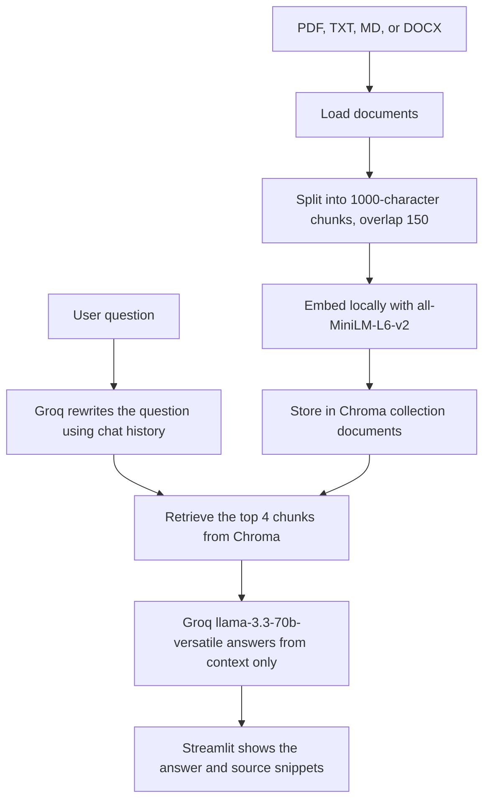

# RAG Chat Assistant

A domain-specific chatbot that answers questions from your own documents using
Retrieval-Augmented Generation (RAG).

**Stack:** LangChain · Groq (chat) · Hugging Face embeddings (local) · Chroma · Streamlit

## How it works



1. **Ingest** — documents (`.pdf`, `.txt`, `.md`, `.docx`) are split into ~1000-character
   chunks, embedded locally with `all-MiniLM-L6-v2`, and stored in a persistent
   Chroma database.
2. **Retrieve** — each question (rewritten to be standalone using chat history) pulls
   the 4 most relevant chunks from Chroma.
3. **Generate** — a Groq-hosted LLM answers strictly from the retrieved context and
   cites sources. If the answer isn't in your documents, it says so.

## Setup

Requires Python 3.10+ and a free [Groq API key](https://console.groq.com/).

```powershell
# 1. Create a virtual environment and install dependencies
python -m venv .venv
.\.venv\Scripts\Activate.ps1
pip install -r requirements.txt

# 2. Configure environment
copy .env.example .env
# Edit .env and set GROQ_API_KEY
```

The first ingest downloads the embedding model from Hugging Face (~80 MB) into your
local cache. After that, embeddings run offline.

## Usage

### Option A: Web UI (recommended)

```powershell
streamlit run app.py
```

Upload documents in the sidebar, click **Ingest uploaded files**, and start chatting.
Each answer includes an expandable **Sources** section showing the retrieved snippets.

### Option B: CLI ingestion

Drop files into the `data/` folder, then:

```powershell
python -m src.ingest            # ingest everything in data/
python -m src.ingest report.pdf # or ingest specific files
```

The index persists in `chroma_db/`, so you only need to ingest each document once.

## Configuration

All settings live in `.env`:

| Variable        | Default                                  | Description            |
| --------------- | ---------------------------------------- | ---------------------- |
| `GROQ_API_KEY`  | *(required)*                             | Groq API key           |
| `CHAT_MODEL`    | `llama-3.3-70b-versatile`                | Groq chat model        |
| `EMBED_MODEL`   | `sentence-transformers/all-MiniLM-L6-v2` | Local embedding model  |
| `CHROMA_DIR`    | `chroma_db`                              | Vector store directory |
| `DATA_DIR`      | `data`                                   | Source documents       |

## Project structure

```
app.py            Streamlit chat UI
src/config.py     Settings loaded from .env
src/llm.py        Groq chat + local HF embedding factories (cached)
src/ingest.py     Document loading, chunking, indexing (also a CLI)
src/rag.py        History-aware conversational RAG chain
data/             Your source documents
chroma_db/        Persistent vector index (auto-created)
```

## Notes

- Chat requires an internet connection (Groq API). Embeddings run locally.
- If you change `EMBED_MODEL`, delete the `chroma_db/` folder and re-ingest —
  embeddings from different models are incompatible.
- To rebuild the index from scratch, delete `chroma_db/` and re-ingest.
